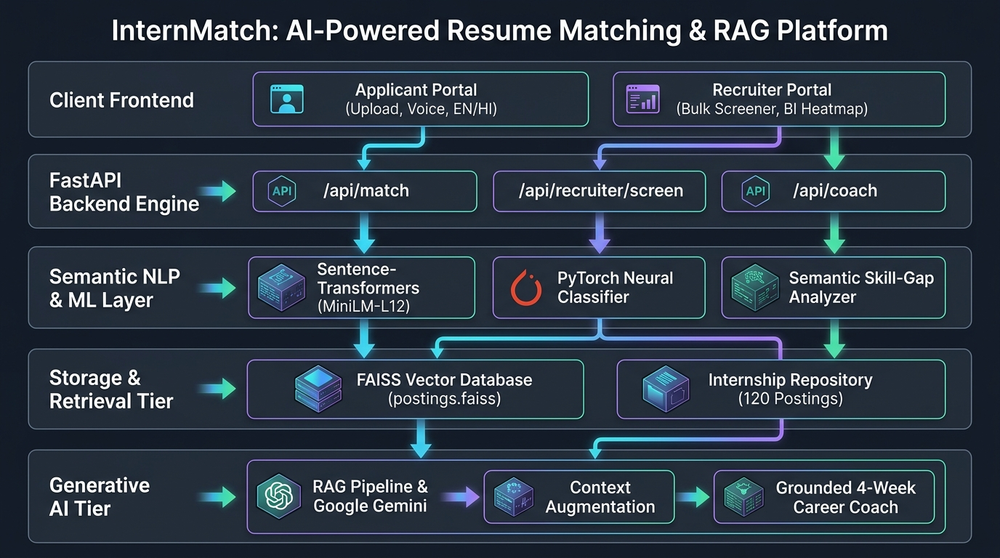

# InternMatch: AI-Powered Resume-Internship Matching & RAG Platform



InternMatch is an intelligent, dual-portal career and recruitment intelligence platform using semantic NLP, dense vector embeddings, FAISS indexing, and Generative AI (RAG with Google Gemini) to match candidate resumes across 24 industry domains.


---

## 🌟 Key Features

- **🎓 Applicant Portal**:
  - Semantic resume matching against 24 domains and popular tech tracks (AIML, Data Science, Full Stack, Cloud/DevOps, Cybersecurity).
  - Cross-domain compatibility scoring.
  - Skill gap diagnostics: Matched skills, related/transferable skills, and prioritized missing skills.
  - Gemini AI 4-week step-by-step career roadmap and resume bullet-point optimization tips.
  - Multilingual support (English and Hindi) + Web Speech voice dictation.
  - Multi-format ingestion (text paste, PDF with native parsing, and Gemini multimodal OCR fallback for scanned resumes).

- **💼 Recruiter Portal**:
  - Bulk resume screener: Upload multiple PDFs or paste candidate profiles.
  - Instant mathematical candidate suitability scoring (12% - 98%) and cutoff threshold filtering.
  - Talent Acquisition BI: Skill saturation heatmap (Supply-Demand Ratio), 5-stage conversion pipeline funnel, 8-axis competency radar, and what-if hiring simulator.
  - One-click CSV and PDF shortlist export.

---

## 🏗️ Architecture & Technology Stack

- **Frontend**: Vanilla HTML5, CSS3 (Aurora glassmorphism design system), modern JavaScript (ES6+), SVG visualizations.
- **Backend API**: Python 3.11, FastAPI, Uvicorn asynchronous REST service.
- **ML & Semantic Matching**:
  - `sentence-transformers/all-MiniLM-L12-v2` (384-dimensional dense semantic vectors).
  - Fine-tuned PyTorch neural classifier (`Matcher` in `backend/engine.py`).
  - FAISS (Facebook AI Similarity Search) in-memory vector index for sub-10ms retrieval.
- **Generative AI & RAG**:
  - Google Gemini API (`gemini-3.8-flash` with automatic fallback).
  - Context augmentation strictly grounded on retrieved job requirements and computed skill gaps to eliminate hallucinations.
  - PII redaction (email, phone, links scrubbed before external LLM calls).

---

## 🚀 Quickstart Guide

### 1. Clone the Repository
```bash
git clone https://github.com/khusheeranjan01-art/scooby-dooby-doo.git
cd scooby-dooby-doo
```

### 2. Set Up Virtual Environment
```bash
python -m venv venv
# On Windows:
.\venv\Scripts\activate
# On Linux/macOS:
source venv/bin/activate
```

### 3. Install Dependencies
```bash
pip install -r backend/requirements.txt
```

### 4. Configure Environment Variables
Copy `.env.example` to `.env` inside `backend/`:
```bash
cp backend/.env.example backend/.env
```
Open `backend/.env` and add your Google Gemini API key:
```env
GEMINI_API_KEY=your_actual_gemini_api_key_here
GEMINI_MODEL=gemini-3.8-flash
```

### 5. Launch the Application
```bash
cd backend
python -m uvicorn main:app --host 127.0.0.1 --port 8000 --reload
```

Open your browser and navigate to:
- **Home**: `http://127.0.0.1:8000/`
- **Applicant Portal**: `http://127.0.0.1:8000/applicant.html`
- **Recruiter Portal**: `http://127.0.0.1:8000/recruiter.html`

---

## 📂 Project Structure

```
├── backend/
│   ├── artifacts/
│   │   ├── best.pt             # Trained PyTorch neural classification model
│   │   ├── postings.csv        # Database of 120 internship postings across 24 domains
│   │   ├── postings.faiss      # Pre-computed FAISS vector index
│   │   └── _aux.joblib         # Vocabulary, classes & skill weight tables
│   ├── engine.py               # Core ML engine (FAISS search, taxonomy, scoring)
│   ├── llm.py                  # Google Gemini integration (OCR, translation, RAG coach)
│   ├── main.py                 # FastAPI endpoints & recruiter screener
│   ├── requirements.txt        # Backend Python dependencies
│   └── .env.example            # Environment variables template
├── frontend/
│   ├── index.html              # Landing page & portal selection
│   ├── applicant.html          # Applicant workspace & match analyzer
│   ├── recruiter.html          # Recruiter portal (Screener + BI analytics)
│   ├── app.js                  # Applicant portal logic & API client
│   ├── analytics.js            # Recruiter analytics, heatmaps & simulator engine
│   ├── style.css               # Main design system styles
│   └── analytics.css           # Recruiter dashboard styling
├── .gitignore                  # Git exclusion rules (strictly ignores .env and venv)
└── README.md                   # Project documentation
```
